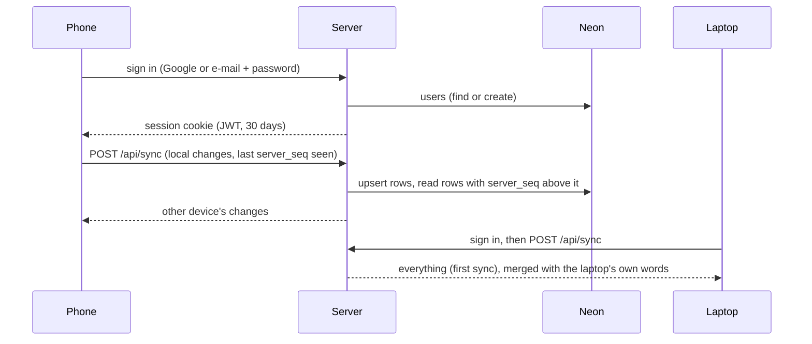
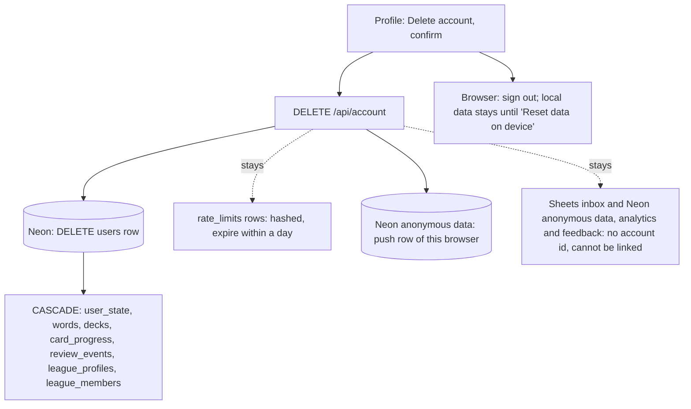

# VocabX — data map

What data the app has, where it lives, why, who can reach it and how long it stays. Written
from the code (session 4 of `docs/PRELAUNCH_PLAN.md`, 2026-11-12; steps 1.3 and 5.4). The source
for `/privacy` (step 1.4). **Rule:** a new kind of data (a table or column, a browser key, a
cookie, a spreadsheet sheet, a third party) gets its row here in the same change.

Retention: "now" is what the code does today; "approved" is the 1.6 term (section 6),
**approved by the owner on 2026-11-12**, not implemented yet (session 8 implements it).

## 1. Summary

| Where                                                                    | What                                                                                                                                                                                                                             | Who can read it                                                           |
| ------------------------------------------------------------------------ | -------------------------------------------------------------------------------------------------------------------------------------------------------------------------------------------------------------------------------- | ------------------------------------------------------------------------- |
| Browser of the learner (localStorage, IndexedDB, Cache Storage, cookies) | Everything the app needs to work: words, decks, answers, progress, settings, profile, analytics id                                                                                                                               | The learner (and anyone with the device)                                  |
| Neon (Postgres, AWS `us-east-1`, from the connection host)               | Accounts and the synced copy of the learner's data; league; rate-limit counts; shared translation cache                                                                                                                          | Server code; the owner through the Neon console                           |
| Neon, second project "anonymous data" (`vocabx-anon`, AWS `us-east-2`)   | Analytics events, session rows and daily summaries (only with consent), a copy of the feedback, push subscriptions; no account id, nothing refers to the accounts database (step 3.1, section 3.1a)                              | Server code; the owner through the Neon console                           |
| Google Sheets (owner's spreadsheets, server service account)             | Analytics events and session snapshots (only with consent; an inbox: the nightly cleanup moves the rows to the database and deletes them, so at most a day), daily summaries without ids ("Когорти", "Дні"), old feedback copies | Server code; the owner and whoever the owner shares the spreadsheets with |
| Telegram chat (owner's bot)                                              | Feedback, when the polls spreadsheet is not set up                                                                                                                                                                               | Members of the owner's chat                                               |
| Third parties reached at run time                                        | Google Translate, Google OAuth, SMTP (Gmail by default), browser push services, Sentry (errors), Tatoeba, Wiktionary, Free Dictionary, the browser's speech services, Vercel (hosting, logs, CDN)                                | Each under its own terms (section 5)                                      |

## 2. Browser storage (step 5.4)

All of it is strictly necessary for the app to work, or is analytics that runs only after consent
(`vocabx:analytics:*` keys are written before consent too, see the note). Nothing is shared with
other sites; there are no third-party cookies or trackers.

### 2.1 Cookies

| Name                                                                   | Set by                             | Holds                                                                                                                                         | Lifetime                                        | Purpose                                                                         |
| ---------------------------------------------------------------------- | ---------------------------------- | --------------------------------------------------------------------------------------------------------------------------------------------- | ----------------------------------------------- | ------------------------------------------------------------------------------- |
| `__Secure-next-auth.session-token` (`next-auth.session-token` on http) | next-auth, `lib/session-cookie.ts` | Encrypted JWT: account id (`sub`), e-mail and the moment it signed in (`authAt`, see `lib/sessions.ts`); `lib/auth.ts` drops name and picture | 30 days                                         | Being signed in                                                                 |
| `__Host-next-auth.csrf-token`                                          | next-auth                          | Random token + its hash                                                                                                                       | Browser session                                 | Protects the sign-in forms                                                      |
| `__Secure-next-auth.callback-url`                                      | next-auth                          | Page to return to after sign-in                                                                                                               | Browser session                                 | Sign-in redirect                                                                |
| `__Secure-next-auth.state`, `__Secure-next-auth.pkce.code_verifier`    | next-auth, Google sign-in only     | Random OAuth values                                                                                                                           | 15 minutes                                      | Google OAuth safety (state, PKCE)                                               |
| `vocabx-email-proof`                                                   | `api/account/register`             | HMAC of the e-mail and the registration (no address in clear)                                                                                 | 24 hours, path `/api/account` only, httpOnly    | Proves the link in a letter is opened in the browser that registered (AUDIT A1) |
| `NEXT_LOCALE`                                                          | next-intl (`src/proxy.ts`)         | `uk` or `en`                                                                                                                                  | Browser session (next-intl 4 sets no `max-age`) | Interface language                                                              |

### 2.2 localStorage — the app's data (`vocabx:v1:*`, `packages/data/src/local`)

| Key                         | Holds                                                                                | Synced to Neon when signed in   | In the export file |
| --------------------------- | ------------------------------------------------------------------------------------ | ------------------------------- | ------------------ |
| `vocabx:v1:meta`            | Storage format version                                                               | no                              | no                 |
| `vocabx:v1:profile`         | Display name, interface / native / learned languages, onboarding time                | yes (`user_state.profile`)      | yes                |
| `vocabx:v1:settings`        | Settings (study, look, sound, league joined, font size…)                             | yes (`user_state.settings`)     | yes                |
| `vocabx:v1:gamification`    | XP, level, streak, character look and items                                          | yes (`user_state.gamification`) | yes                |
| `vocabx:v1:words`           | The learner's own words: term, translations, examples, optional image URL / video id | yes (`words`)                   | yes                |
| `vocabx:v1:decks`           | The learner's decks                                                                  | yes (`decks`)                   | yes                |
| `vocabx:v1:progress:<lang>` | Card state per word (FSRS), due time                                                 | yes (`card_progress`)           | yes                |
| `vocabx:v1:log`             | Every answer: word id, time, grade, format, response time, XP                        | yes (`review_events`)           | yes                |
| `vocabx:v1:stats`           | Daily totals derived from the log                                                    | no (rebuilt)                    | yes                |

Lives until the learner resets data on the device or clears the browser. No expiry.

### 2.3 localStorage — service keys

| Key                                                                                                                  | Holds                                                                                       | Lifetime                                                               |
| -------------------------------------------------------------------------------------------------------------------- | ------------------------------------------------------------------------------------------- | ---------------------------------------------------------------------- |
| `vocabx:sync`                                                                                                        | Ids of local changes not yet sent to the server (no values)                                 | Until sent                                                             |
| `vocabx:sync:session`                                                                                                | Time the sign-in was last checked                                                           | Overwritten                                                            |
| `vocabx:cache:google-translations`, `…:wiktionary-translations-v2`, `…:free-dictionary`, `…:wiktionary`, `…:tatoeba` | Answers of the online dictionaries for words looked up on this device                       | 30 days, at most 400 entries per source (`lib/lexicon/use-lexicon.ts`) |
| `vocabx:league`, `vocabx:league-wait`                                                                                | Last league standings shown (names and looks of the group), "waiting for the week to start" | Overwritten; removed on leaving the league                             |
| `vocabx:tour:home`, `…:game`, `…:review`, `…:words`, `…:library`, `…:mine`                                           | "Tour seen" flags                                                                           | Until reset                                                            |
| `vocabx:probe`                                                                                                       | Empty test write (is storage available)                                                     | Removed at once                                                        |
| `vocabx:backup-nudge`                                                                                                | Number of started words when "Keep your words" was last shown or a file saved (§2.6)        | Overwritten                                                            |

### 2.4 localStorage / sessionStorage — analytics (`lib/analytics/identity.ts`)

Kept apart from `vocabx:v1:*`: a data reset keeps them. `anon_id` is random, made in the browser,
never sent with account or sync requests and never stored next to an account (step 1.2 tests).

| Key                                                                             | Holds                                                           |
| ------------------------------------------------------------------------------- | --------------------------------------------------------------- |
| `vocabx:analytics:consent`                                                      | The answer to the consent question                              |
| `vocabx:analytics:anon-id`                                                      | Random browser id                                               |
| `vocabx:analytics:first-visit`                                                  | Date of the first visit (for "days since first visit")          |
| `vocabx:analytics:internal`                                                     | Developer / test visit flag (`?internal=1`, localhost)          |
| `vocabx:analytics:session`, `…:session-count`, `…:last-session-end`, `…:streak` | Current session id and counters                                 |
| `vocabx:analytics:onboarding-step`                                              | Last onboarding step reached                                    |
| `vocabx:analytics:outbox`                                                       | Events not yet sent (sent on the next visit, only with consent) |
| `vocabx:analytics:debug` (sessionStorage, per tab)                              | `?debug=1`: print events instead of sending                     |

Note for `/privacy`: the id and counters are kept on the device before consent too; nothing is
sent without consent (step 1.1). Whether a pre-consent random id counts as "strictly necessary"
is a legal question for the owner's review (session 5).

### 2.5 Other browser storage

| Store                       | Name                                   | Holds                                                                                                                                                                                 | Lifetime                                               |
| --------------------------- | -------------------------------------- | ------------------------------------------------------------------------------------------------------------------------------------------------------------------------------------- | ------------------------------------------------------ |
| IndexedDB                   | `vocabx-sw`, store `kv`, key `summary` | Reminder text and how many words wait / when others come due (no word texts)                                                                                                          | Overwritten                                            |
| Push subscription (browser) | —                                      | The push address of this browser at its push service                                                                                                                                  | Until reminders are turned off or the browser drops it |
| Cache Storage               | `vocabx-<build>`                       | App pages and files for offline use, one store per build of the app (the older ones are dropped); `/__vocabx/meta` (home page and time of the last warm-up). `/api/*` is never cached | Replaced on each app update                            |
| Web Locks                   | `vocabx-sync`, `vocabx-export`         | Nothing stored: only stops two tabs syncing / exporting at once                                                                                                                       | —                                                      |

### 2.6 Local data durability (step 6.4, measured 2026-11-12)

Without an account this browser holds the only copy of the learner's data.

**Size** (`packages/data/src/local/durability.test.ts`, realistic ids, UTF-16 characters):

| Part                                   | Size                    |
| -------------------------------------- | ----------------------- |
| Answer log, per 1000 answers           | about 88 000 characters |
| Card state, per started word           | about 282               |
| Own word (2 translations, one example) | about 333               |
| Daily stats, per day                   | about 84                |

The log keeps the newest 5000 answers (older ones live on in the stats and cards). The full log
with 2000 started words, a year of stats and 300 own words is about 1.14 million characters:
43 % of 5 MiB counted as 2 bytes a character (the strictest reading; MDN: about 5 MiB of
localStorage per origin). In that reading room is left for about 5000 more started words
(about 7000 in all).

**Storage full** (`LocalStorageRepo.makeRoom`): a write that does not fit first drops the cached
online lookups (`vocabx:cache:*`), then the older half of the answer log, and is tried again. Ids
of dropped answers leave the sync journal, so they never go to the server as deletions. Learning
state (cards, stats, words, decks, settings) is never dropped. If still nothing fits, the review
shows "The browser is out of space" with the way out (download a copy, sign in), the card stays
on screen, and `storage_error` is counted. A migration that does not fit puts the old data back
with its old version (the app then runs on an empty in-memory store and tries again next start);
an import that does not fit leaves the data as it was.

**What the browsers do** (MDN "Storage quotas and eviction criteria" and WebKit "Updates to
Storage Policy", 2023, read 2026-11-12):

- localStorage is part of the origin's storage: under disk pressure a browser evicts a
  best-effort origin as a whole (all its storage at once).
- `navigator.storage.persist()` asks for persistent mode (evicted only by the user). Chrome and
  Safari decide silently (engagement, installed web app); Firefox shows a permission prompt. The
  app asks once the learner has 20 started words (`keepStorage` in `lib/backup.ts`, called on
  Home), so the Firefox prompt never comes on a first visit. Settings → Data shows the result.
- Safari with tracking prevention deletes script-written data (localStorage included) of a site
  without user interaction in the last 7 days of Safari use. A web app added to the Home Screen
  has its own counter and is not affected while it is used. Neither source says that persistent
  mode exempts a site from this rule, so it is assumed not to. Not checked on a device (needs a
  week of Safari use).
- No CSP or Permissions-Policy entry governs `persist()`; nothing new goes over the network.

**Way out** (also for the accepted domain risk, owner decision 6.1): learners without an account
see "Keep your words" on Home (from 20 started words, not on the first day, again every 100 more
words): sign in, or download the file that Settings → Data → "Restore from a file" puts back, on
any device or address. Restoring is offered only without an account (an account has the server
copy).

**Before a domain move** (whenever it happens): keep the old address serving the app for at least
a few weeks with a notice to sign in or download a copy; data stays per address, so nothing
moves by itself. PWA installs and push subscriptions have to be made again on the new address.

**For the threat model (2.6):** "cleared browser / Safari's 7-day rule without an account" →
lost unless signed in or a file was saved (protection: nudge, restore, `persist()`); "lost phone"
→ the same; with an account, everything synced is on the server, only changes made offline since
the last sync are lost.

## 3. Server data

### 3.1 Neon tables (`apps/web/src/lib/db/schema.ts`)

Every learner table refers to `users` with `ON DELETE CASCADE`: "Delete account" (`DELETE
/api/account`) removes the user row and with it every row below except the two shared tables.
The same learner tables are what "Download my data" (`GET /api/account/export`, `lib/account-export.ts`)
lists, without the password hash, the pending password and the link-token hashes. The reminder
row (`push_subscriptions` in the anonymous-data database) is not tied to an account: the browser that deletes the account sends its own
push address, and that row is removed (`removeReminderDb`); other browsers' rows stay until their own
retention ends. Tested on the test database (`account.db.test.ts`).

| Table               | Fields (personal ones in bold)                                                                                                                                                                                                                                                            | Written by                                                                                    | Purpose                                                   | Retention now                                                                                       | Approved (1.6)                                                                                                                                                  |
| ------------------- | ----------------------------------------------------------------------------------------------------------------------------------------------------------------------------------------------------------------------------------------------------------------------------------------- | --------------------------------------------------------------------------------------------- | --------------------------------------------------------- | --------------------------------------------------------------------------------------------------- | --------------------------------------------------------------------------------------------------------------------------------------------------------------- |
| `users`             | id, **email**, **google_sub**, **password_hash** (scrypt), pending_password_hash, email_verified_at, verify_token_hash / expires / sent_at (hash of the latest link), sessions_since (sessions signed in before it no longer count), created_at, deleted_at, login_failures, locked_until | sign-in, `api/account/*`                                                                      | The account                                               | Until "Delete account" (hard delete). Unconfirmed accounts and stale link hashes stay forever       | Unconfirmed accounts (no Google, no confirmed e-mail) deleted 7 days after the last letter; link hashes and pending passwords cleared 7 days after they expired |
| `user_state`        | **profile** (display name, languages), settings, gamification (JSON)                                                                                                                                                                                                                      | `api/sync`                                                                                    | Synced profile and settings                               | Until account deletion                                                                              | same                                                                                                                                                            |
| `words`             | **term**, lang, data (translations, examples, image URL, video id), deleted_at                                                                                                                                                                                                            | `api/sync`                                                                                    | Synced words                                              | Live rows: until account deletion. Tombstones (`deleted_at`): forever                               | Tombstones purged after 90 days (see 6.2 for why not 30)                                                                                                        |
| `decks`             | data (title, words), deleted_at                                                                                                                                                                                                                                                           | `api/sync`                                                                                    | Synced decks                                              | as `words`                                                                                          | as `words`                                                                                                                                                      |
| `card_progress`     | word_id, card state, due_at, deleted_at                                                                                                                                                                                                                                                   | `api/sync`                                                                                    | Synced progress                                           | as `words`                                                                                          | as `words`                                                                                                                                                      |
| `review_events`     | word_id, at, grade, format, response_ms, xp, credited_xp, deleted_at                                                                                                                                                                                                                      | `api/sync`                                                                                    | Synced answers (source of the cards)                      | as `words`                                                                                          | Tombstones as `words`; live answers kept (they are the learner's history)                                                                                       |
| `league_profiles`   | **name** (shown to others), look, frame, tier, joined_at, last_result                                                                                                                                                                                                                     | `api/league`                                                                                  | League participation, after the learner chose it          | Until leaving / deletion                                                                            | same                                                                                                                                                            |
| `league_members`    | week, user_id, group_id, tier, xp, xp_at                                                                                                                                                                                                                                                  | `api/league`, `api/sync`                                                                      | Weekly groups                                             | Forever (one row per week taken part)                                                               | Weeks older than 12 weeks deleted                                                                                                                               |
| `rate_limits`       | key (rule + **HMAC** of the sender address /64, account id or e-mail — never in clear), count, reset_at                                                                                                                                                                                   | `lib/rate-limit.ts` (translate, register, reset, sign-in, dev-unlock, feedback, sync, league) | Limits on costly routes (steps 2.1a, 2.1b)                | Until its window ends (15 minutes to 1 day) + up to an hour; each check deletes up to 20 ended rows | same, plus the cleanup cron deletes what checks left                                                                                                            |
| `translation_cache` | key `from\|to\|word`, Google's translations, created_at                                                                                                                                                                                                                                   | `api/translate`                                                                               | One answer for everyone, so a repeated word costs nothing | 30 days (`CACHE_MS`); each write deletes up to 20 older rows                                        | **15 days** (6.7: see `docs/LICENSES.md` §2.1), plus the cleanup cron                                                                                           |

Since session 8 the "Approved (1.6)" column is what runs: the daily cleanup (`/api/cleanup`,
terms in `apps/web/src/lib/retention.ts`, see §6.3); "Retention now" shows the state before it.
`verify_token_hash` also holds the link of an address change: the hash of the token together with
the new address (the new address itself is only in the letter's link, never stored before it is
confirmed).

**To drop:** `users.login_failures`, `users.locked_until` (unused since 2.1a: wrong passwords count
in `rate_limits`) and (owner, 2026-11-12) `users.deleted_at` (written by nothing: deletion is hard;
AUDIT §5). Since session 8 no code reads them; migration `0006_drop_unused_user_columns` drops them
(undo SQL in the file). Apply it only after that deploy is live, so the old version never meets a
missing column.

The translation cache has no link to a person: the key is the word, not who asked. The learner's
own confirmed translation is stored with their word (`words.data`), like anything they type.

### 3.1a Neon project "anonymous data" (`apps/web/src/lib/db/anon-schema.ts`, `drizzle-anon/`, step 3.1)

A second project (`DATABASE_URL_ANON`; test branch `DATABASE_URL_ANON_TEST`), so an `anon_id` is
physically not in the database that holds `users`, and the statistics cannot use up the accounts
database's compute hours. No `user_id`, e-mail or IP anywhere in it, and no foreign key to the
accounts database; `privacy.test.ts` checks the schema and which code may open it
(`anonDbFromEnv`: track, feedback, push, cleanup, the analytics store, the reminder store).
Design and its numbers: `docs/ANALYTICS_DB.md`.

| Table                | Fields                                                                                                                                                          | Written by                                                  | Term (approved 2026-11-13)       |
| -------------------- | --------------------------------------------------------------------------------------------------------------------------------------------------------------- | ----------------------------------------------------------- | -------------------------------- |
| `events`             | event_id (key), ts, type, anon_id, session_id, internal, host, ui_lang, device, days_since_first_visit, game/study mode, params (all event parameters, as sent) | Nightly copy from the «Події» sheet                         | 14 days                          |
| `sessions`           | session_id (key), anon_id, the session summary (counters, times, modes), `final`; the newest snapshot wins                                                      | Nightly copy from the «Сесії» sheet                         | 90 days                          |
| `devices`            | anon_id (key), first visit, cohort day, internal, ui_lang, device, last seen, funnel milestones (booleans)                                                      | Computed from sessions and events by the copy               | 12 months after last seen        |
| `device_days`        | anon_id + day since first visit: sessions, answers, active seconds                                                                                              | Computed by the copy                                        | 12 months                        |
| `event_days`         | Kyiv day, event type, main parameter, internal: events and devices counted                                                                                      | Computed by the copy                                        | 12 months                        |
| `feedback`           | received_at, kind, anon_id, the rest of the form by column name (**free text** may hold anything the learner types)                                             | `api/feedback` (next to the sheets); the one-off import     | 24 months                        |
| `push_subscriptions` | **push endpoint**, on/off, locale, next reminder time, updated_at                                                                                               | `api/push` (next to the sheet); the nightly copy of the tab | Off: 30 days; no change: 90 days |

Until step 3.1d the spreadsheet stays the main place and the database follows it ("copy mode": the
nightly `/api/cleanup` reads the tabs and writes new rows here, the sheets are only read).
`pnpm analytics:import` is the same function run once over the whole history. Deleting the
account removes the browser's push row here too (`api/account`).

### 3.2 Google Sheets (owner's spreadsheets, `lib/google-sheets.ts`)

| Spreadsheet / sheet       | Fields                                                                                                                                                                                                                                                                     | Written by                      | Retention now                                                                                          | Approved (1.6)                 |
| ------------------------- | -------------------------------------------------------------------------------------------------------------------------------------------------------------------------------------------------------------------------------------------------------------------------- | ------------------------------- | ------------------------------------------------------------------------------------------------------ | ------------------------------ |
| Analytics / «Події»       | ts, type, anon_id, session_id, internal, host, ui_lang, device, days_since_first_visit, game/study mode, event params (screen, step, grade, response_ms…), event_id. Never: e-mail, name, IP, user agent, word text, account id (tests in `lib/analytics/privacy.test.ts`) | `api/track`, only after consent | Inbox: moved to the database and deleted every night (at most a day; 365 days if the database is down) | 14 days in the database (§6.1) |
| Analytics / «Сесії»       | started/ended, anon_id, session_id, counters (answers, accuracy, active time); one row per snapshot of a session                                                                                                                                                           | `api/track`, only after consent | As «Події»                                                                                             | 90 days in the database (§6.1) |
| Analytics / «Словник»     | Column descriptions                                                                                                                                                                                                                                                        | `api/track`                     | Rewritten on server start                                                                              | —                              |
| Analytics / «Відгуки»     | Old copy of feedback (new ones go to the database only)                                                                                                                                                                                                                    | none now                        | 24 months                                                                                              | 24 months                      |
| Analytics / «Нагадування» | Leftover of the old storage of push endpoints (now `push_subscriptions` in the anonymous-data database)                                                                                                                                                                    | none now                        | Emptied by the nightly cleanup                                                                         | —                              |
| Polls / feedback sheet    | time, kind (survey / bug / review / idea), ui_lang, player level, ratings, **free text** (may hold anything the learner types), likes/improve choices, device type, platform, anon_id                                                                                      | `api/feedback`                  | Forever                                                                                                | 24 months                      |

Since session 8 the "Approved (1.6)" column is what runs (rows deleted by the daily cleanup).

### 3.3 Other places

| Place                                                                   | What                                                                                                                                                         | Retention                                                                                                                                                               |
| ----------------------------------------------------------------------- | ------------------------------------------------------------------------------------------------------------------------------------------------------------ | ----------------------------------------------------------------------------------------------------------------------------------------------------------------------- |
| Telegram chat (`TELEGRAM_BOT_TOKEN`, `TELEGRAM_CHAT_ID`)                | Feedback text, when the polls spreadsheet is not set up                                                                                                      | Chat history: until the owner deletes it (a bot can delete its messages only within 48 hours, so this stays manual)                                                     |
| Mailbox of the sending account (SMTP, Gmail unless `EMAIL_SERVER_HOST`) | Sent letters: the learner's **e-mail** and the confirm / reset link                                                                                          | Owner's mailbox "Sent" folder; owner deletes by hand or turns off saving sent mail                                                                                      |
| Vercel logs                                                             | Request lines with the sender's **IP**, path (the word asked in `/api/translate?q=` is in the URL), status; `console.error` texts (no secrets, no addresses) | Hobby keeps runtime logs **1 hour** (Vercel docs, checked 2026-11-12); error lines carry a route name and a code, never an address or a mail server's text (session 10) |
| Vercel CDN                                                              | Cached answers of `/api/translate` (`s-maxage` 15 days since session 8) and `/api/dictionary` (1 day)                                                        | As in the header: 15 days for translate, same as the cache (6.7)                                                                                                        |
| Neon history (point-in-time restore)                                    | Old versions of every row, deleted ones too                                                                                                                  | The plan's restore window (free tier); step 4.3 / session 16 records it                                                                                                 |

## 4. Diagrams

### 4.1 One answer

```mermaid
flowchart LR
  A[Swipe / answer] --> B[log entry in vocabx:v1:log]
  B --> C[FSRS: new card state in vocabx:v1:progress]
  C --> D[id marked in vocabx:sync]
  D -->|signed in, online| E[POST /api/sync]
  E --> F[(Neon: review_events, card_progress)]
  E --> G[(league_members.xp, if in the league)]
  A -->|consent given| H[tracker: event without word text]
  H --> I[POST /api/track]
  I --> J[(Sheets: Події / Сесії)]
  J -. nightly copy, step 3.1 .-> J2[(Neon anonymous data: events, sessions, summaries)]
  A -->|no consent| K[nothing sent]
```

### 4.2 Sign-in and two devices



### 4.3 Account deletion



The push row (anonymous-data database) and the browser's own push subscription go with the
account deletion (AUDIT A11); the old reminder tab in Sheets is emptied by the nightly cleanup
(`clearLegacyReminders`).

## 5. Third parties (see `docs/LICENSES.md` for terms and attribution)

| Service                                      | What it receives                                                                                                                                                                                                                                | From                                                  | When                                                       |
| -------------------------------------------- | ----------------------------------------------------------------------------------------------------------------------------------------------------------------------------------------------------------------------------------------------- | ----------------------------------------------------- | ---------------------------------------------------------- |
| Vercel                                       | Every request (IP, user agent, path)                                                                                                                                                                                                            | browser                                               | Always (hosting)                                           |
| Neon                                         | Account and synced data; in a second project, the anonymous statistics, a copy of the feedback and push endpoints                                                                                                                               | server                                                | Sign-in, sync, league, limits, translate                   |
| Google Cloud Translation                     | The word and the language pair                                                                                                                                                                                                                  | server (service account)                              | "Suggest" in the word form, if not in the cache            |
| Google Sheets                                | Analytics inbox rows (a day), summaries, old feedback copies                                                                                                                                                                                    | server (service account)                              | After consent; on feedback; reminders on/off               |
| Google OAuth                                 | The sign-in itself; returns e-mail, Google id, name, picture (only e-mail and Google id are kept)                                                                                                                                               | browser ↔ Google ↔ server                             | "Sign in with Google"                                      |
| SMTP (Gmail by default)                      | Learner's e-mail, the link                                                                                                                                                                                                                      | server                                                | Registration, password reset                               |
| Telegram                                     | Feedback text                                                                                                                                                                                                                                   | server                                                | Feedback, only without the polls spreadsheet               |
| Push services (FCM, Mozilla, Apple, Windows) | An empty push to the browser's endpoint                                                                                                                                                                                                         | server                                                | Reminder due                                               |
| Tatoeba (`api.tatoeba.org`)                  | The word, the language; the browser's IP                                                                                                                                                                                                        | browser directly                                      | Sentence top-up during review, "Suggest"                   |
| Wiktionary (`en.wiktionary.org`)             | The word; for the action API also the browser's IP                                                                                                                                                                                              | browser (translations) and server proxy (definitions) | "Suggest", example top-up                                  |
| Free Dictionary (`api.dictionaryapi.dev`)    | The word                                                                                                                                                                                                                                        | server proxy `/api/dictionary`                        | "Suggest", example top-up                                  |
| Browser speech services                      | Spoken audio in sentence tasks (Chrome sends it to Google; Safari to Apple); text to speak may use online voices                                                                                                                                | browser, outside our code                             | Microphone tasks, pronunciation                            |
| Sentry (EU region, free plan)                | Error reports: kind of error, stack, route path, build id, environment, browser and OS. Scrubbed before sending (`lib/monitoring.ts`): no user, cookies, headers, query, body, breadcrumbs or word text; IP storing switched off in the project | browser and server                                    | Only when `SENTRY_DSN` is set; an error or a cron check-in |
| Google Fonts                                 | Nothing at run time: `next/font` downloads Inter and Manrope at build and serves them from our domain                                                                                                                                           | —                                                     | —                                                          |

## 6. Retention terms (step 1.6, approved by the owner 2026-11-12)

### 6.1 Terms

| Data                                                               | Term                                                                        | Mechanism                                |
| ------------------------------------------------------------------ | --------------------------------------------------------------------------- | ---------------------------------------- |
| Tombstones in `words`, `decks`, `card_progress`, `review_events`   | 90 days after `deleted_at`                                                  | Cleanup cron                             |
| Unconfirmed e-mail accounts                                        | 7 days after the last letter                                                | Cleanup cron                             |
| Link hashes, pending passwords                                     | Cleared 7 days after they expired                                           | Cleanup cron                             |
| `users.deleted_at`, `login_failures`, `locked_until`               | Drop the columns                                                            | Migration after deploy                   |
| `rate_limits`                                                      | End of window + 1 hour (as now)                                             | Checks + cron                            |
| `translation_cache` and its CDN copy                               | 15 days (now 30)                                                            | Writes + cron; `CACHE_MS` and `s-maxage` |
| `league_members`                                                   | 12 weeks                                                                    | Cleanup cron                             |
| Push rows (`push_subscriptions`, anonymous-data database)          | Off: 30 days; not updated: 90 days                                          | Cleanup cron                             |
| Analytics events and sessions in the spreadsheet (inbox)           | At most a day: moved to the database and deleted every night (step 3.1d)    | Cleanup cron (Sheets: delete old rows)   |
| Analytics raw events (database `events`)                           | 14 days (owner, 2026-11-13)                                                 | Cleanup cron (`purgeAnalytics`)          |
| Analytics session rows (`sessions`)                                | 90 days                                                                     | Cleanup cron                             |
| Analytics daily summaries (`devices`, `device_days`, `event_days`) | 12 months                                                                   | Cleanup cron                             |
| Feedback (both spreadsheets and the database copy)                 | 24 months                                                                   | Cleanup cron; Telegram by hand           |
| Learner's account and synced data                                  | Until the learner deletes it; no auto-delete of inactive accounts at launch | —                                        |
| Local browser data                                                 | Until the learner resets it                                                 | —                                        |

### 6.2 Why 90 days, not 30, for tombstones

A device learns about a deletion from its tombstone. A device that stays offline longer than the
purge term would never learn of it and could send the deleted word back. 90 days covers a phone
left in a drawer for a season; the rows are small.

The rule for such a device (session 8, `@vocabx/data`): the browser notes when an answer last left
nothing unseen on the server (`caughtUpAt` in its sync journal). If that was more than 80 days ago
(`FULL_RESYNC_MS`, 10 days short of the term so a clock a few days off still errs on the safe
side), it fetches everything from the start; every row the server sends (alive or as a tombstone)
is ticked off, and at the end the rows it had already sent but the server never mentioned are
removed here. Rows changed here meanwhile stay and go to the server ("an edit brings it back", as
always). Chosen over the planned "server keeps the highest purged `server_seq`": same guarantee,
no new column or migration before the deploy, and the server and old browsers are unchanged.

### 6.3 Mechanism and free-tier fit (6.9)

One more daily Vercel cron: `/api/cleanup` at 03:00 UTC (`vercel.json`), `CRON_SECRET`, answers
and logs only row counts. Checked 2026-11-12 in Vercel's docs: Hobby allows 100 cron jobs per
project, each at most once a day (and only within the hour), so a second cron fits and reminders
stay daily (17:00 UTC) unless the owner adds a free outside scheduler. The database gets one
request a run (`db.batch`), each statement capped at 2000 rows (the rest goes the next day), so
Neon wakes once a day. The spreadsheets: one column read per tab and one `batchUpdate` deleting
row runs bottom-up; the reminder tab is read whole (it is small). A failing step is logged and
skipped; the others still run. The cron runs at night, away from the reminder cron, because a row
deleted while another request is between reading and writing the same tab could shift that write.
