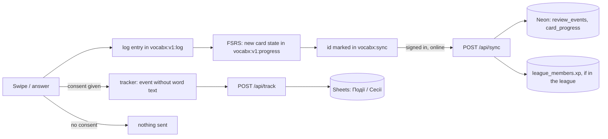
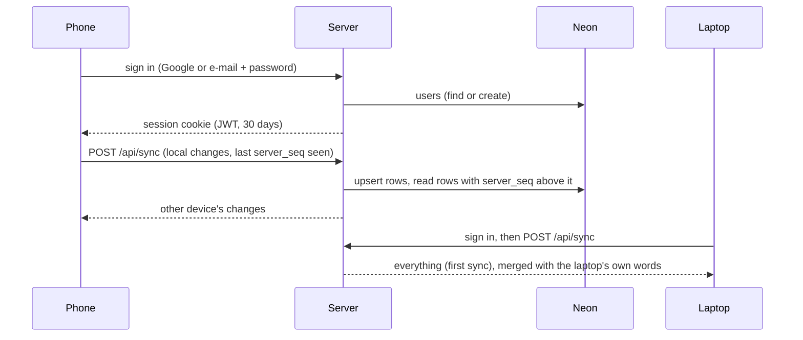

# VocabX — data map

What data the app has, where it lives, why, who can reach it and how long it stays. Written
from the code (session 4 of `docs/PRELAUNCH_PLAN.md`, 2026-11-12; steps 1.3 and 5.4). The source
for `/privacy` (step 1.4). **Rule:** a new kind of data (a table or column, a browser key, a
cookie, a spreadsheet sheet, a third party) gets its row here in the same change.

Retention: "now" is what the code does today; "approved" is the 1.6 term (section 6),
**approved by the owner on 2026-11-12**, not implemented yet (session 8 implements it).

## 1. Summary

| Where                                                                    | What                                                                                                                                                                             | Who can read it                                                           |
| ------------------------------------------------------------------------ | -------------------------------------------------------------------------------------------------------------------------------------------------------------------------------- | ------------------------------------------------------------------------- |
| Browser of the learner (localStorage, IndexedDB, Cache Storage, cookies) | Everything the app needs to work: words, decks, answers, progress, settings, profile, analytics id                                                                               | The learner (and anyone with the device)                                  |
| Neon (Postgres, AWS `us-east-1`, from the connection host)               | Accounts and the synced copy of the learner's data; league; rate-limit counts; shared translation cache                                                                          | Server code; the owner through the Neon console                           |
| Google Sheets (owner's spreadsheets, server service account)             | Analytics events and sessions (only with consent), feedback, push subscriptions for reminders                                                                                    | Server code; the owner and whoever the owner shares the spreadsheets with |
| Telegram chat (owner's bot)                                              | Feedback, when the polls spreadsheet is not set up                                                                                                                               | Members of the owner's chat                                               |
| Third parties reached at run time                                        | Google Translate, Google OAuth, SMTP (Gmail by default), browser push services, Tatoeba, Wiktionary, Free Dictionary, the browser's speech services, Vercel (hosting, logs, CDN) | Each under its own terms (section 5)                                      |

## 2. Browser storage (step 5.4)

All of it is strictly necessary for the app to work, or is analytics that runs only after consent
(`vocabx:analytics:*` keys are written before consent too, see the note). Nothing is shared with
other sites; there are no third-party cookies or trackers.

### 2.1 Cookies

| Name                                                                   | Set by                             | Holds                                                                                    | Lifetime                                        | Purpose                                                                         |
| ---------------------------------------------------------------------- | ---------------------------------- | ---------------------------------------------------------------------------------------- | ----------------------------------------------- | ------------------------------------------------------------------------------- |
| `__Secure-next-auth.session-token` (`next-auth.session-token` on http) | next-auth, `lib/session-cookie.ts` | Encrypted JWT: account id (`sub`) and e-mail only (`lib/auth.ts` drops name and picture) | 30 days                                         | Being signed in                                                                 |
| `__Host-next-auth.csrf-token`                                          | next-auth                          | Random token + its hash                                                                  | Browser session                                 | Protects the sign-in forms                                                      |
| `__Secure-next-auth.callback-url`                                      | next-auth                          | Page to return to after sign-in                                                          | Browser session                                 | Sign-in redirect                                                                |
| `__Secure-next-auth.state`, `__Secure-next-auth.pkce.code_verifier`    | next-auth, Google sign-in only     | Random OAuth values                                                                      | 15 minutes                                      | Google OAuth safety (state, PKCE)                                               |
| `vocabx-email-proof`                                                   | `api/account/register`             | HMAC of the e-mail and the registration (no address in clear)                            | 24 hours, path `/api/account` only, httpOnly    | Proves the link in a letter is opened in the browser that registered (AUDIT A1) |
| `NEXT_LOCALE`                                                          | next-intl (`src/proxy.ts`)         | `uk` or `en`                                                                             | Browser session (next-intl 4 sets no `max-age`) | Interface language                                                              |

### 2.2 localStorage — the app's data (`vocabx:v1:*`, `packages/data/src/local`)

| Key                         | Holds                                                                                | Synced to Neon when signed in   | In the export file |
| --------------------------- | ------------------------------------------------------------------------------------ | ------------------------------- | ------------------ |
| `vocabx:v1:meta`            | Storage format version                                                               | no                              | no                 |
| `vocabx:v1:profile`         | Display name, interface / native / learned languages, onboarding time                | yes (`user_state.profile`)      | yes                |
| `vocabx:v1:settings`        | Settings (study, look, sound, league joined, font size…)                             | yes (`user_state.settings`)     | yes                |
| `vocabx:v1:gamification`    | XP, level, streak, character look and items                                          | yes (`user_state.gamification`) | yes                |
| `vocabx:v1:words`           | The learner's own words: term, translations, examples, optional image URL / video id | yes (`words`)                   | yes                |
| `vocabx:v1:decks`           | The learner's decks                                                                  | yes (`decks`)                   | yes                |
| `vocabx:v1:progress:<lang>` | Card state per word (FSRS), due time                                                 | yes (`card_progress`)           | yes                |
| `vocabx:v1:log`             | Every answer: word id, time, grade, format, response time, XP                        | yes (`review_events`)           | yes                |
| `vocabx:v1:stats`           | Daily totals derived from the log                                                    | no (rebuilt)                    | yes                |

Lives until the learner resets data on the device or clears the browser. No expiry.

### 2.3 localStorage — service keys

| Key                                                                                                                  | Holds                                                                                       | Lifetime                                                               |
| -------------------------------------------------------------------------------------------------------------------- | ------------------------------------------------------------------------------------------- | ---------------------------------------------------------------------- |
| `vocabx:sync`                                                                                                        | Ids of local changes not yet sent to the server (no values)                                 | Until sent                                                             |
| `vocabx:sync:session`                                                                                                | Time the sign-in was last checked                                                           | Overwritten                                                            |
| `vocabx:cache:google-translations`, `…:wiktionary-translations-v2`, `…:free-dictionary`, `…:wiktionary`, `…:tatoeba` | Answers of the online dictionaries for words looked up on this device                       | 30 days, at most 400 entries per source (`lib/lexicon/use-lexicon.ts`) |
| `vocabx:league`, `vocabx:league-wait`                                                                                | Last league standings shown (names and looks of the group), "waiting for the week to start" | Overwritten; removed on leaving the league                             |
| `vocabx:tour:home`, `…:game`, `…:review`, `…:words`, `…:library`, `…:mine`                                           | "Tour seen" flags                                                                           | Until reset                                                            |
| `vocabx:probe`                                                                                                       | Empty test write (is storage available)                                                     | Removed at once                                                        |

### 2.4 localStorage / sessionStorage — analytics (`lib/analytics/identity.ts`)

Kept apart from `vocabx:v1:*`: a data reset keeps them. `anon_id` is random, made in the browser,
never sent with account or sync requests and never stored next to an account (step 1.2 tests).

| Key                                                                             | Holds                                                           |
| ------------------------------------------------------------------------------- | --------------------------------------------------------------- |
| `vocabx:analytics:consent`                                                      | The answer to the consent question                              |
| `vocabx:analytics:anon-id`                                                      | Random browser id                                               |
| `vocabx:analytics:first-visit`                                                  | Date of the first visit (for "days since first visit")          |
| `vocabx:analytics:internal`                                                     | Developer / test visit flag (`?internal=1`, localhost)          |
| `vocabx:analytics:session`, `…:session-count`, `…:last-session-end`, `…:streak` | Current session id and counters                                 |
| `vocabx:analytics:onboarding-step`                                              | Last onboarding step reached                                    |
| `vocabx:analytics:outbox`                                                       | Events not yet sent (sent on the next visit, only with consent) |
| `vocabx:analytics:debug` (sessionStorage, per tab)                              | `?debug=1`: print events instead of sending                     |

Note for `/privacy`: the id and counters are kept on the device before consent too; nothing is
sent without consent (step 1.1). Whether a pre-consent random id counts as "strictly necessary"
is a legal question for the owner's review (session 5).

### 2.5 Other browser storage

| Store                       | Name                                   | Holds                                                                                                                    | Lifetime                                               |
| --------------------------- | -------------------------------------- | ------------------------------------------------------------------------------------------------------------------------ | ------------------------------------------------------ |
| IndexedDB                   | `vocabx-sw`, store `kv`, key `summary` | Reminder text and how many words wait / when others come due (no word texts)                                             | Overwritten                                            |
| Push subscription (browser) | —                                      | The push address of this browser at its push service                                                                     | Until reminders are turned off or the browser drops it |
| Cache Storage               | `vocabx-v2`                            | App pages and files for offline use; `/__vocabx/meta` (home page and time of the last warm-up). `/api/*` is never cached | Replaced on each app update                            |
| Web Locks                   | `vocabx-sync`, `vocabx-export`         | Nothing stored: only stops two tabs syncing / exporting at once                                                          | —                                                      |

## 3. Server data

### 3.1 Neon tables (`apps/web/src/lib/db/schema.ts`)

Every learner table refers to `users` with `ON DELETE CASCADE`: "Delete account" (`DELETE
/api/account`) removes the user row and with it every row below except the two shared tables.

| Table               | Fields (personal ones in bold)                                                                                                                                                                                             | Written by                                                            | Purpose                                                   | Retention now                                                                                       | Approved (1.6)                                                                                                                                                  |
| ------------------- | -------------------------------------------------------------------------------------------------------------------------------------------------------------------------------------------------------------------------- | --------------------------------------------------------------------- | --------------------------------------------------------- | --------------------------------------------------------------------------------------------------- | --------------------------------------------------------------------------------------------------------------------------------------------------------------- |
| `users`             | id, **email**, **google_sub**, **password_hash** (scrypt), pending_password_hash, email_verified_at, verify_token_hash / expires / sent_at (hash of the latest link), created_at, deleted_at, login_failures, locked_until | sign-in, `api/account/*`                                              | The account                                               | Until "Delete account" (hard delete). Unconfirmed accounts and stale link hashes stay forever       | Unconfirmed accounts (no Google, no confirmed e-mail) deleted 7 days after the last letter; link hashes and pending passwords cleared 7 days after they expired |
| `user_state`        | **profile** (display name, languages), settings, gamification (JSON)                                                                                                                                                       | `api/sync`                                                            | Synced profile and settings                               | Until account deletion                                                                              | same                                                                                                                                                            |
| `words`             | **term**, lang, data (translations, examples, image URL, video id), deleted_at                                                                                                                                             | `api/sync`                                                            | Synced words                                              | Live rows: until account deletion. Tombstones (`deleted_at`): forever                               | Tombstones purged after 90 days (see 6.2 for why not 30)                                                                                                        |
| `decks`             | data (title, words), deleted_at                                                                                                                                                                                            | `api/sync`                                                            | Synced decks                                              | as `words`                                                                                          | as `words`                                                                                                                                                      |
| `card_progress`     | word_id, card state, due_at, deleted_at                                                                                                                                                                                    | `api/sync`                                                            | Synced progress                                           | as `words`                                                                                          | as `words`                                                                                                                                                      |
| `review_events`     | word_id, at, grade, format, response_ms, xp, credited_xp, deleted_at                                                                                                                                                       | `api/sync`                                                            | Synced answers (source of the cards)                      | as `words`                                                                                          | Tombstones as `words`; live answers kept (they are the learner's history)                                                                                       |
| `league_profiles`   | **name** (shown to others), look, frame, tier, joined_at, last_result                                                                                                                                                      | `api/league`                                                          | League participation, after the learner chose it          | Until leaving / deletion                                                                            | same                                                                                                                                                            |
| `league_members`    | week, user_id, group_id, tier, xp, xp_at                                                                                                                                                                                   | `api/league`, `api/sync`                                              | Weekly groups                                             | Forever (one row per week taken part)                                                               | Weeks older than 12 weeks deleted                                                                                                                               |
| `rate_limits`       | key (rule + **HMAC** of the sender address /64, account id or e-mail — never in clear), count, reset_at                                                                                                                    | `lib/rate-limit.ts` (translate, register, reset, sign-in, dev-unlock) | Limits on costly routes (step 2.1a)                       | Until its window ends (15 minutes to 1 day) + up to an hour; each check deletes up to 20 ended rows | same, plus the cleanup cron deletes what checks left                                                                                                            |
| `translation_cache` | key `from\|to\|word`, Google's translations, created_at                                                                                                                                                                    | `api/translate`                                                       | One answer for everyone, so a repeated word costs nothing | 30 days (`CACHE_MS`); each write deletes up to 20 older rows                                        | **15 days** (6.7: see `docs/LICENSES.md` §2.1), plus the cleanup cron                                                                                           |

**To drop (separate migration after the next deploy):** `users.login_failures`,
`users.locked_until` (unused since 2.1a: wrong passwords count in `rate_limits`) and (owner, 2026-11-12)
`users.deleted_at` (written by nothing: deletion is hard; AUDIT §5). Drop them only
after the deploy that stops reading them is live, so the old version never meets a missing column.

The translation cache has no link to a person: the key is the word, not who asked. The learner's
own confirmed translation is stored with their word (`words.data`), like anything they type.

### 3.2 Google Sheets (owner's spreadsheets, `lib/google-sheets.ts`)

| Spreadsheet / sheet       | Fields                                                                                                                                                                                                                                                                     | Written by                      | Retention now                   | Approved (1.6)                                                       |
| ------------------------- | -------------------------------------------------------------------------------------------------------------------------------------------------------------------------------------------------------------------------------------------------------------------------- | ------------------------------- | ------------------------------- | -------------------------------------------------------------------- |
| Analytics / «Події»       | ts, type, anon_id, session_id, internal, host, ui_lang, device, days_since_first_visit, game/study mode, event params (screen, step, grade, response_ms…), event_id. Never: e-mail, name, IP, user agent, word text, account id (tests in `lib/analytics/privacy.test.ts`) | `api/track`, only after consent | Forever                         | 12 months                                                            |
| Analytics / «Сесії»       | started/ended, anon_id, session_id, counters (answers, accuracy, active time)                                                                                                                                                                                              | `api/track`, only after consent | Forever                         | 12 months                                                            |
| Analytics / «Словник»     | Column descriptions                                                                                                                                                                                                                                                        | `api/track`                     | Rewritten on server start       | —                                                                    |
| Analytics / «Відгуки»     | Copy of feedback (see below)                                                                                                                                                                                                                                               | `api/feedback`                  | Forever                         | 24 months                                                            |
| Analytics / «Нагадування» | **push endpoint** (the browser's push address), on/off, ui_lang, updated_at, next reminder time                                                                                                                                                                            | `api/push`, `api/push/cron`     | Forever, also switched-off rows | Off rows deleted after 30 days; rows not updated for 90 days deleted |
| Polls / feedback sheet    | time, kind (survey / bug / review / idea), ui_lang, player level, ratings, **free text** (may hold anything the learner types), likes/improve choices, device type, platform, anon_id                                                                                      | `api/feedback`                  | Forever                         | 24 months                                                            |

### 3.3 Other places

| Place                                                                   | What                                                                                                                                                         | Retention                                                                                                           |
| ----------------------------------------------------------------------- | ------------------------------------------------------------------------------------------------------------------------------------------------------------ | ------------------------------------------------------------------------------------------------------------------- |
| Telegram chat (`TELEGRAM_BOT_TOKEN`, `TELEGRAM_CHAT_ID`)                | Feedback text, when the polls spreadsheet is not set up                                                                                                      | Chat history: until the owner deletes it (a bot can delete its messages only within 48 hours, so this stays manual) |
| Mailbox of the sending account (SMTP, Gmail unless `EMAIL_SERVER_HOST`) | Sent letters: the learner's **e-mail** and the confirm / reset link                                                                                          | Owner's mailbox "Sent" folder; owner deletes by hand or turns off saving sent mail                                  |
| Vercel logs                                                             | Request lines with the sender's **IP**, path (the word asked in `/api/translate?q=` is in the URL), status; `console.error` texts (no secrets, no addresses) | Free plan keeps runtime logs for a short time; step 2.4 measures and records it here                                |
| Vercel CDN                                                              | Cached answers of `/api/translate` (`s-maxage` 30 days) and `/api/dictionary` (1 day)                                                                        | As in the header; **approved 15 days** for translate, same as the cache (6.7)                                       |
| Neon history (point-in-time restore)                                    | Old versions of every row, deleted ones too                                                                                                                  | The plan's restore window (free tier); step 4.3 / session 16 records it                                             |

## 4. Diagrams

### 4.1 One answer



### 4.2 Sign-in and two devices



### 4.3 Account deletion

```mermaid
flowchart TD
  A[Profile: Delete account, confirm] --> B[DELETE /api/account]
  B --> C[(Neon: DELETE users row)]
  C --> D[CASCADE: user_state, words, decks, card_progress, review_events, league_profiles, league_members]
  B -. not yet, step 1.5 .-> E[Sheets: push row of this browser]
  B -. stays .-> F[rate_limits rows: hashed, expire within a day]
  B -. stays .-> G[Sheets analytics and feedback: no account id, cannot be linked]
  A --> H[Browser: sign out; local data stays until 'Reset data on device']
```

Gaps that step 1.5 closes: the push row in Sheets and the browser's push subscription (AUDIT
A11); a check on a test DB that nothing stays.

## 5. Third parties (see `docs/LICENSES.md` for terms and attribution)

| Service                                      | What it receives                                                                                                 | From                                                  | When                                            |
| -------------------------------------------- | ---------------------------------------------------------------------------------------------------------------- | ----------------------------------------------------- | ----------------------------------------------- |
| Vercel                                       | Every request (IP, user agent, path)                                                                             | browser                                               | Always (hosting)                                |
| Neon                                         | Account and synced data                                                                                          | server                                                | Sign-in, sync, league, limits, translate        |
| Google Cloud Translation                     | The word and the language pair                                                                                   | server (service account)                              | "Suggest" in the word form, if not in the cache |
| Google Sheets                                | Analytics rows, feedback, push endpoints                                                                         | server (service account)                              | After consent; on feedback; reminders on/off    |
| Google OAuth                                 | The sign-in itself; returns e-mail, Google id, name, picture (only e-mail and Google id are kept)                | browser ↔ Google ↔ server                             | "Sign in with Google"                           |
| SMTP (Gmail by default)                      | Learner's e-mail, the link                                                                                       | server                                                | Registration, password reset                    |
| Telegram                                     | Feedback text                                                                                                    | server                                                | Feedback, only without the polls spreadsheet    |
| Push services (FCM, Mozilla, Apple, Windows) | An empty push to the browser's endpoint                                                                          | server                                                | Reminder due                                    |
| Tatoeba (`api.tatoeba.org`)                  | The word, the language; the browser's IP                                                                         | browser directly                                      | Sentence top-up during review, "Suggest"        |
| Wiktionary (`en.wiktionary.org`)             | The word; for the action API also the browser's IP                                                               | browser (translations) and server proxy (definitions) | "Suggest", example top-up                       |
| Free Dictionary (`api.dictionaryapi.dev`)    | The word                                                                                                         | server proxy `/api/dictionary`                        | "Suggest", example top-up                       |
| Browser speech services                      | Spoken audio in sentence tasks (Chrome sends it to Google; Safari to Apple); text to speak may use online voices | browser, outside our code                             | Microphone tasks, pronunciation                 |
| Google Fonts                                 | Nothing at run time: `next/font` downloads Inter and Manrope at build and serves them from our domain            | —                                                     | —                                               |

## 6. Retention terms (step 1.6, approved by the owner 2026-11-12)

### 6.1 Terms

| Data                                                             | Term                                                                        | Mechanism                                |
| ---------------------------------------------------------------- | --------------------------------------------------------------------------- | ---------------------------------------- |
| Tombstones in `words`, `decks`, `card_progress`, `review_events` | 90 days after `deleted_at`                                                  | Cleanup cron                             |
| Unconfirmed e-mail accounts                                      | 7 days after the last letter                                                | Cleanup cron                             |
| Link hashes, pending passwords                                   | Cleared 7 days after they expired                                           | Cleanup cron                             |
| `users.deleted_at`, `login_failures`, `locked_until`             | Drop the columns                                                            | Migration after deploy                   |
| `rate_limits`                                                    | End of window + 1 hour (as now)                                             | Checks + cron                            |
| `translation_cache` and its CDN copy                             | 15 days (now 30)                                                            | Writes + cron; `CACHE_MS` and `s-maxage` |
| `league_members`                                                 | 12 weeks                                                                    | Cleanup cron                             |
| Push rows in Sheets                                              | Off: 30 days; not updated: 90 days                                          | Cleanup cron                             |
| Analytics events and sessions                                    | 12 months                                                                   | Cleanup cron (Sheets: delete old rows)   |
| Feedback (both spreadsheets)                                     | 24 months                                                                   | Cleanup cron; Telegram by hand           |
| Learner's account and synced data                                | Until the learner deletes it; no auto-delete of inactive accounts at launch | —                                        |
| Local browser data                                               | Until the learner resets it                                                 | —                                        |

### 6.2 Why 90 days, not 30, for tombstones

A device learns about a deletion from its tombstone. A device that stays offline longer than the
purge term would never learn of it and could send the deleted word back. 90 days covers a phone
left in a drawer for a season; the rows are small. Session 8 also adds a rule: the server keeps
the highest purged `server_seq`, and a device whose last-seen number is below it does a full
resync instead of an incremental one.

### 6.3 Mechanism and free-tier fit (6.9)

One more daily Vercel cron (`/api/cleanup`, `CRON_SECRET`, logs only row counts), or a step at the
end of the existing `/api/push/cron` if the cron count of the free plan is used up. Each run
deletes in batches with a cap, so a run stays short and the database wakes once a day. Free-plan
cron runs once a day at most, so reminders stay daily (17:00 UTC) unless the owner adds a free
outside scheduler; session 8 checks the current limits before choosing.
